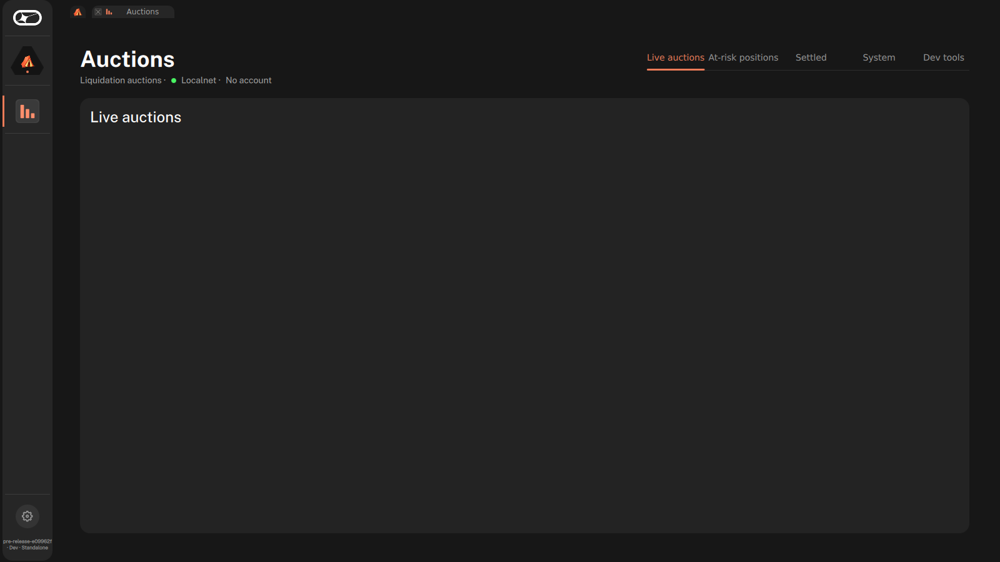

# Basecamp app

## Host

The Auctions app is developed and run in Basecamp's standalone mode, inside WSL. `scripts/basecamp/host.sh` builds the two things it needs and guards the C: disk.

Pinned inputs:

| Input | Pin | Output used |
|---|---|---|
| Basecamp | `github:logos-co/logos-basecamp/e09962f5998792afd3bfed8c69c3b8f07f5825a5` (2026-10-15, version `0.0.0-dev`) | `#app-standalone` |
| lez_core wallet module | `github:logos-blockchain/logos-execution-zone-module?rev=acf0cd501b262c4c15969e3735e85318297b85bf` (`lez_core` 0.4.1) | `#install` |

`#app-standalone` already has the QML inspector on (port 3768). `#install` is an install root with `modules/lez_core/` (plugin, `libwallet_ffi.so`, `manifest.json`) and an empty `plugins/`. The dev build variant matches the `#install` output (the portable variant would pair with `#install-portable`). Nix is 2.34.8.

Commands (inside WSL, or from Git Bash, where the script re-runs itself through `wsl`):

```bash
scripts/basecamp/host.sh check   # "C: <N> GB free (min 10): ok"; exit 2 and "refusing: ..." below the minimum
scripts/basecamp/host.sh build   # check, nix build Basecamp, check, nix build lez_core, check
scripts/basecamp/host.sh paths   # BASECAMP_BIN=... and LEZ_CORE_ROOT=... lines
```

`MIN_C_GB` overrides the 10 GB minimum (`MIN_C_GB=1000 scripts/basecamp/host.sh check` exits 2). Result links are under `~/lez-target/basecamp/` (`app`, `lez_core`). The WSL disk is a file on C:, so C: free space is what runs out; the first build took C: from 31 GB to 18 GB free.

Launch smoke (empty install root with `modules/` and `plugins/`):

```bash
EMPTY=$(mktemp -d); mkdir -p $EMPTY/modules $EMPTY/plugins
XDG_RUNTIME_DIR=/mnt/wslg/runtime-dir $BASECAMP_BIN --user-dir "$(mktemp -d)" \
  --modules-dir $LEZ_CORE_ROOT --module $EMPTY
```

Result: the app starts, the log shows `Inspector server listening on port 3768`, and a TCP connection to `localhost:3768` is accepted. Without `XDG_RUNTIME_DIR` Basecamp aborts in WSL. `--user-dir` keeps the run out of `./.logos-basecamp-dev`.

## Skeleton end-to-end (lez_core proof)

`scripts/basecamp/run-app.sh` runs the Auctions app in standalone Basecamp against a localnet:

```bash
scripts/basecamp/run-app.sh [--setup] [--test FILE]
```

- `--setup` first runs `scripts/demo.sh --setup-only --sequencer-dev-mode 1`: the demo phases `accounts` to `positions`, then it keeps the sequencer running and prints `AUCTIONS_DEPLOYMENT=… LEE_WALLET_HOME_DIR=…` (the run's filled deployment file and wallet, never `deployments/localnet.json`).
- It builds `modules/auction_engine#install` and `apps/auctions#install` (result links under `~/lez-target/basecamp/`) and launches `$BASECAMP_BIN --modules-dir $LEZ_CORE_ROOT --modules-dir <auction_engine install> --module <auctions install>` with that environment, `AUCTIONS_STATE_DIR=<run dir>/cli-state` (the CLI's locks) and `XDG_RUNTIME_DIR=/mnt/wslg/runtime-dir`. The Basecamp log is `<run dir>/logs/basecamp.log`.
- `--test FILE` runs `node FILE` against the inspector on port 3768 (logos-qt-mcp from Basecamp `e09962f5`), exits with its code, and stops Basecamp and, with `--setup`, the sequencer. Without `--test` both keep running.

`apps/auctions/tests/skeleton.mjs` opens Dev tools, transfers `1` from `owner-stable` to `taker-stable`, waits up to 120 s for `devTransferStatus` to read `Done`, and checks with `auction-cli dev balance --account taker-stable` that the balance rose by 1. `SKELETON_SCREENSHOT=<png>` also saves a screenshot of the header and the five tabs.

Result (2026-10-25, inside WSL, Basecamp `e09962f5`, lez_core `acf0cd50`, sequencer in dev mode):

```text
$ scripts/basecamp/run-app.sh --setup --test apps/auctions/tests/skeleton.mjs
...
Running 1 test(s)...

    taker-stable balance: 0 -> 1
  ✓ skeleton: Dev tools token transfer goes through lez_core and lands on chain

1 passed, 0 failed
```

So `lez_core` loads in Basecamp master, accepts the plan's account ids, signer flags, instruction words as little-endian bytes and the program id hex, and sends a transaction that the sequencer includes (ADR-018). The keystore signing fallback is not needed.


